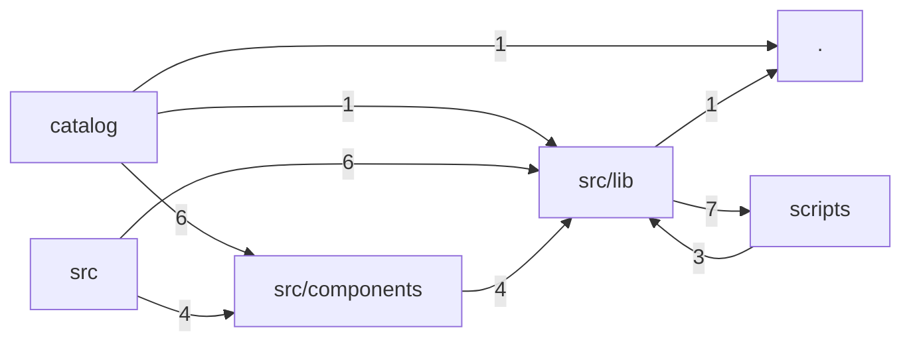

# Layers

## src/components

| Forbidden import                      | Message                                                                                                                                                                                                                                                                                   |
| ------------------------------------- | ----------------------------------------------------------------------------------------------------------------------------------------------------------------------------------------------------------------------------------------------------------------------------------------- |
| `^(\.\./)+(?:src/)?(layouts\|pages)/` | `src/components/** cannot import from src/layouts/ or src/pages/. Pass layout or page data and markup via props or <slot /> from src/layouts/ or src/pages/, and put shared helpers or types in src/lib/ or another component under src/components/. Do not silence with oxlint-disable.` |

## src/lib

| Forbidden import                                  | Message                                                                                                                                                                                                                                                                      |
| ------------------------------------------------- | ---------------------------------------------------------------------------------------------------------------------------------------------------------------------------------------------------------------------------------------------------------------------------- |
| `^(\.\./)+(?:src/)?(components\|layouts\|pages)/` | `src/lib/** cannot import from src/components/, src/layouts/, or src/pages/. Move shared logic or types into src/lib/ (library tests may import scripts/), or move UI-dependent code into src/components/, src/layouts/, or src/pages/. Do not silence with oxlint-disable.` |
